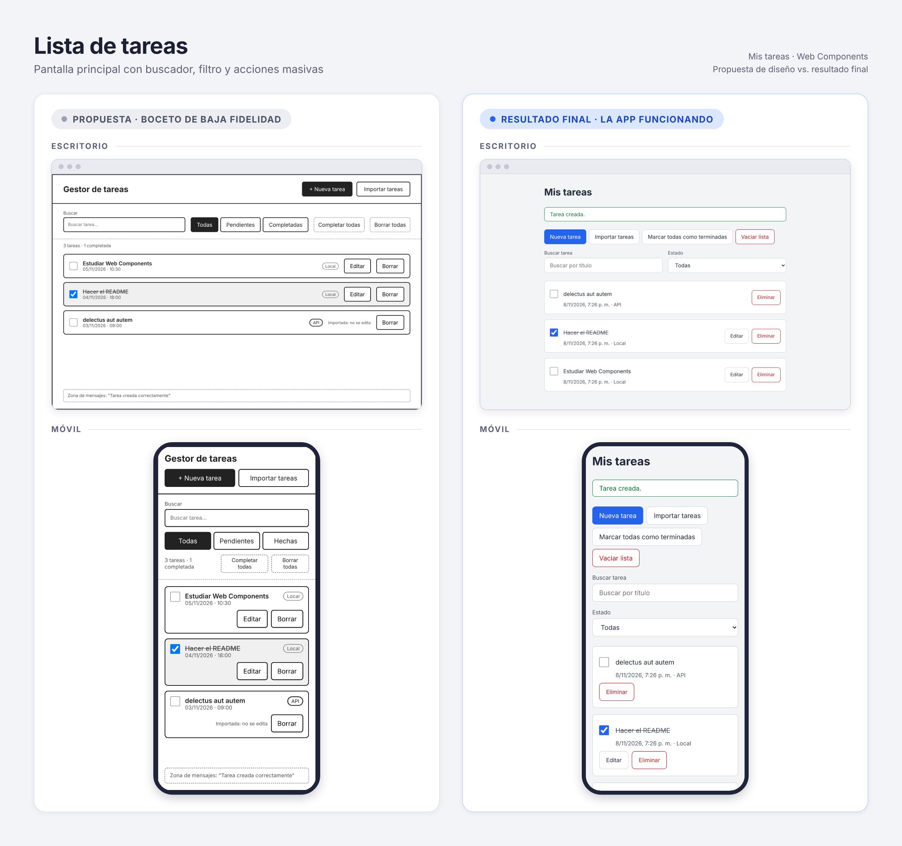
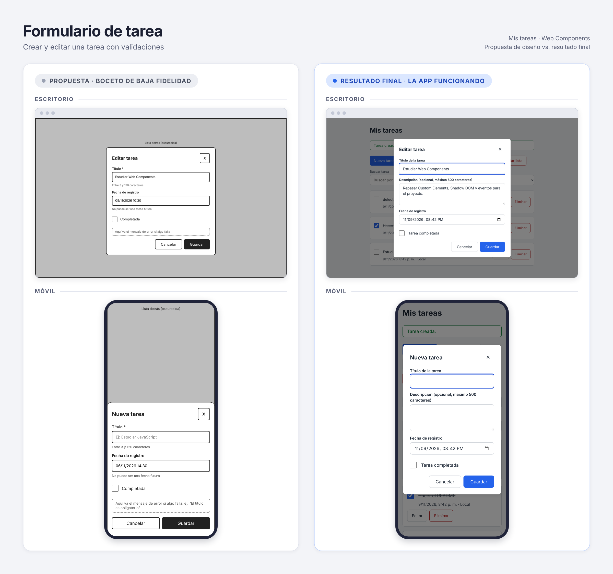
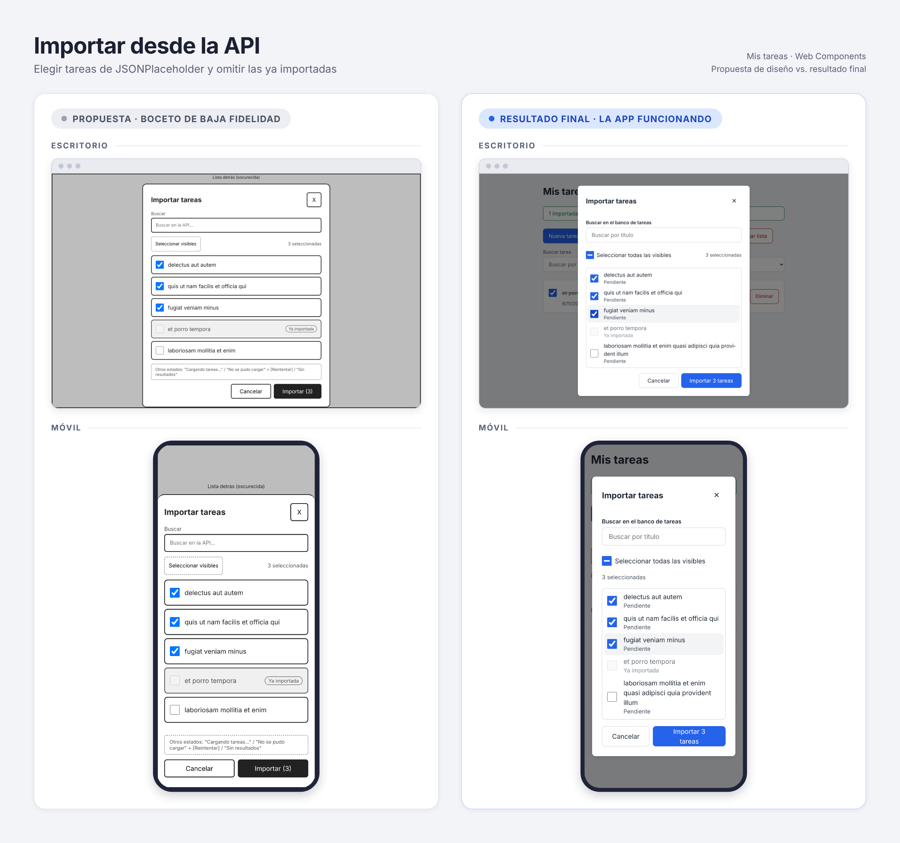
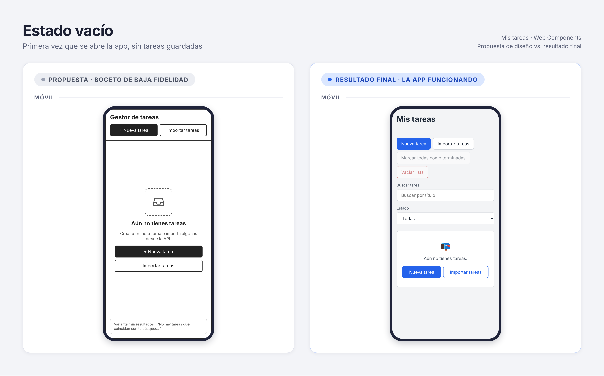

# Mis tareas

Gestor de tareas hecho con **HTML, CSS y JavaScript nativos**, usando **Web Components** (Custom Elements con Shadow DOM). Las tareas se guardan en el navegador (`localStorage`) y también se pueden importar desde la API pública [JSONPlaceholder](https://jsonplaceholder.typicode.com/todos).

Proyecto de Campuslands (módulo de JavaScript), desarrollado en pareja por **Alan Márquez** y **Rodrigo Trujillo**.

## Contenido

1. [Descripción](#1-descripción)
2. [Arquitectura](#2-arquitectura)
3. [Instalación y ejecución](#3-instalación-y-ejecución)
4. [Diseño: propuesta frente al resultado final](#4-diseño-propuesta-frente-al-resultado-final)
5. [Herramientas utilizadas](#5-herramientas-utilizadas)
6. [Pruebas manuales](#6-pruebas-manuales)
7. [Decisiones tomadas](#7-decisiones-tomadas)
8. [Autores](#8-autores)

## 1. Descripción

**Mis tareas** es una aplicación web para organizar tareas pendientes. Cada tarea tiene un **título**, una **descripción** (opcional), una **fecha de registro** y un **estado** (pendiente o completada). La persona puede crear sus propias tareas o traer algunas desde una API pública, y todo queda guardado en el navegador.

### Qué se puede hacer

- **Crear** tareas con título, descripción, fecha de registro y estado, en un formulario que se abre como ventana modal.
- **Editar** el título, la descripción, la fecha y el estado de una tarea local. La lista solo muestra el título y la fecha; la descripción se consulta al editar.
- **Marcar** una tarea como completada o pendiente.
- **Eliminar** una tarea, con confirmación.
- **Buscar** por título y **filtrar** por estado (todas, pendientes, completadas).
- **Marcar todas como terminadas** y **vaciar la lista**, ambas con confirmación.
- **Importar tareas desde la API:** se elige cuáles con un buscador y casillas, y se omiten las que ya fueron importadas.
- **Persistencia:** al recargar la página, las tareas siguen ahí.
- **Estados claros:** lista vacía, sin resultados, cargando y error de conexión con botón "Reintentar".

### Reglas de las tareas importadas

- No se pueden editar (no aparece el botón **Editar**): solo se pueden marcar como completadas y eliminar.
- Una misma tarea de la API no se puede importar dos veces.
- Todas las tareas de un mismo lote comparten la fecha y hora en que se importaron.
- Las tareas de la API no traen descripción: la guardan vacía.

### Validaciones

- **Título:** obligatorio, de 3 a 120 caracteres.
- **Descripción:** opcional, de hasta 500 caracteres.
- **Fecha:** debe ser válida y no puede ser futura.
- Título y descripción rechazan caracteres de control invisibles.
- Si falla la API o el almacenamiento del navegador, la aplicación muestra un mensaje claro y no se rompe.

## 2. Arquitectura

La aplicación es **estática**, sin servidor propio ni frameworks. Cada pieza de la interfaz es un **Web Component** (Custom Element con `attachShadow({ mode: 'open' })`) que se registra en su propio archivo con `customElements.define`; `main.js` solo los importa.

### Estructura del proyecto

```
Gestion_Tareas/
├── index.html
├── README.md
├── css/
│   └── global.css          # variables de color, espacios y tipografía
├── docs/
│   ├── contratos.md        # acuerdo técnico entre los dos integrantes
│   ├── diseno-y-logica.md  # arquitectura, eventos y propuesta vs. resultado
│   └── wireframes/         # bocetos, capturas finales y láminas comparativas
└── js/
    ├── main.js             # punto de entrada: importa los componentes
    ├── components/
    │   ├── task-app.js         # componente raíz: dueño del estado
    │   ├── task-toolbar.js     # botones, buscador y filtro
    │   ├── task-list.js        # lista y estados vacíos
    │   ├── task-item.js        # una tarea
    │   ├── task-form-modal.js  # formulario para crear y editar
    │   ├── import-modal.js     # importar desde la API
    │   ├── confirm-dialog.js   # confirmaciones
    │   └── app-modal.js        # modal base reutilizable
    ├── services/
    │   ├── storage.js      # lectura y escritura en localStorage
    │   └── api.js          # consumo de JSONPlaceholder
    └── utils/
        ├── utils.js        # filtro, formato de fechas y foco
        └── validators.js   # validaciones del formulario
```

### Cómo se reparten el trabajo

| Capa | Archivos | Qué hace |
|---|---|---|
| Componentes | `js/components/` | Dibujan la interfaz y avisan con eventos lo que hizo la persona. |
| Servicios | `js/services/` | `storage.js` guarda en `localStorage`; `api.js` consulta la API. |
| Utilidades | `js/utils/` | Funciones puras: validaciones, filtro y formato de fechas. |

### Una sola fuente de verdad

`task-app` es el **único** componente que guarda el estado y habla con `storage.js`. Los demás reciben datos por propiedades y avisan lo ocurrido con eventos personalizados (`CustomEvent` con `bubbles` y `composed`, para atravesar el Shadow DOM). El flujo siempre es el mismo: evento de la persona → `task-app` actúa sobre `storage.js` → `task-app` vuelve a leer y repinta.

### Modelo de datos

Las tareas se guardan en `localStorage` con la clave `tasks:v1`, como un arreglo JSON:

```json
{
  "id": "LOC-3f2a9c1e-8b7d-4e2a-9f1c-1a2b3c4d5e6f",
  "titulo": "Estudiar Web Components",
  "descripcion": "Repasar Custom Elements y Shadow DOM",
  "fechaRegistro": "2026-11-05T10:30:00.000Z",
  "completado": false,
  "origen": "local",
  "apiId": null,
  "imported": false
}
```

- **Identificadores:** `LOC-` más un UUID para las tareas locales, y `API-` más el id de JSONPlaceholder para las importadas.
- `origen` es `"local"` o `"api"`; `apiId` sirve para detectar duplicados al importar.
- Las tareas guardadas antes de existir la descripción siguen funcionando.

### Más detalle

- **Accesibilidad:** modales con `<dialog>`, cierre con `Escape`, foco atrapado y devuelto al cerrar, avisos con `aria-live`, botones de al menos 44 px y uso de `textContent` en vez de `innerHTML`.
- **Diseño adaptable:** se ve bien desde 320 px de ancho hasta escritorio.
- La lógica completa, la tabla de eventos y las validaciones están en [docs/diseno-y-logica.md](docs/diseno-y-logica.md). El acuerdo técnico entre los integrantes está en [docs/contratos.md](docs/contratos.md).

## 3. Instalación y ejecución

No necesita instalación de paquetes ni compilación. Solo hay que servir la carpeta con un servidor local, porque los módulos de JavaScript no funcionan abriendo el archivo con doble clic.

**Requisitos:** un navegador moderno (Chrome, Edge o Firefox), [Visual Studio Code](https://code.visualstudio.com/) con la extensión **Live Server**, y Git. Para importar tareas se necesita conexión a internet.

1. Clona el repositorio:
   ```bash
   git clone https://github.com/mangouniverse887/ProyectoTareas_JavaScript_TrujilloMarquez.git
   ```
2. Abre la carpeta en **Visual Studio Code** e instala la extensión **Live Server**.
3. Haz clic derecho sobre `Gestion_Tareas/index.html` y elige **Open with Live Server**.
4. Se abre `http://127.0.0.1:5500/Gestion_Tareas/index.html`.

### Despliegue (opcional)

La aplicación es **estática**: no tiene servidor propio, ni instalación, ni paso de compilación (*build*). Se puede publicar en cualquier servicio de hosting estático. Dos puntos son importantes:

- **Directorio base:** el proyecto vive dentro de la carpeta `Gestion_Tareas/`, no en la raíz del repositorio. Al publicar hay que indicar que esa es la carpeta que se sirve.
- **HTTPS:** los hosts estáticos lo incluyen. Se necesita porque la aplicación usa `crypto.randomUUID()` para los identificadores, que solo funciona en `localhost` o en HTTPS.

**Netlify**

1. Opción rápida: entrar a [app.netlify.com/drop](https://app.netlify.com/drop) y arrastrar la carpeta `Gestion_Tareas`.
2. Opción con el repositorio: *Add new site → Import an existing project*, elegir el repositorio y, en la configuración, indicar `Gestion_Tareas` como directorio base. Dejar vacío el comando de *build*.

**Vercel**

1. *Add New → Project* e importar el repositorio.
2. En *Root Directory* elegir `Gestion_Tareas`.
3. En *Framework Preset* elegir **Other** y dejar vacíos los comandos de *build* y *output*.

**GitHub Pages:** con un repositorio privado requiere un plan de pago de GitHub, por eso para este proyecto es más práctico Netlify o Vercel.

Después de publicar, se recomienda abrir la dirección pública y comprobar lo básico: crear una tarea, recargar la página (debe seguir ahí) e importar tareas (necesita internet).

## 4. Diseño: propuesta frente al resultado final

Antes de programar se dibujaron **wireframes** de baja fidelidad de las vistas principales, en móvil y en escritorio. Cada lámina pone el boceto a la izquierda y la aplicación terminada a la derecha.

### Lista de tareas



### Formulario de tarea



### Importar desde la API



### Estado vacío



### Qué cambió y por qué

| Elemento | Propuesta | Resultado final | Motivo |
|---|---|---|---|
| Filtro por estado | Tres botones | Lista desplegable "Estado" | Ocupa menos espacio y se maneja bien con teclado. |
| Acciones masivas | "Completar todas" y "Borrar todas" | "Marcar todas como terminadas" y "Vaciar lista" | Los nombres dicen con más claridad qué hace cada botón. |
| Modales en móvil | Hoja que sube desde abajo | Ventana centrada con `<dialog>` | El navegador ya trae foco, Escape y fondo oscuro. |
| Descripción de la tarea | No estaba | Campo opcional en el formulario | Se agregó por sugerencia del profesor; la lista no la muestra para no cargarla de texto. |
| Confirmaciones | No estaban dibujadas | Cuadro de confirmación al eliminar, marcar todas y vaciar | Son acciones que no se pueden deshacer. |

La tabla completa de cambios está en [docs/diseno-y-logica.md](docs/diseno-y-logica.md#5-propuesta-de-diseño-vs-resultado-final).

## 5. Herramientas utilizadas

| Herramienta | Para qué se usó |
|---|---|
| HTML, CSS y JavaScript (módulos ES) | La aplicación, sin frameworks ni librerías. |
| Web Components y Shadow DOM | Los componentes de la interfaz. |
| `localStorage` y `fetch` | Guardar los datos en el navegador y consumir la API. |
| [JSONPlaceholder](https://jsonplaceholder.typicode.com/todos) | Banco de tareas para importar. |
| Visual Studio Code y Live Server | Editar el código y ejecutarlo en local. |
| Git y GitHub | Control de versiones, ramas y Pull Requests con revisión entre los dos integrantes. |
| Herramientas de desarrollo del navegador (F12) | Probar en distintos tamaños de pantalla y revisar la consola. |
| Claude (asistente de IA) | Apoyo para diseñar los wireframes, revisar el código, redactar la documentación y ejecutar pruebas. El código y las decisiones fueron revisados por el equipo. |

## 6. Pruebas manuales

Se probaron a mano en el navegador, sin errores en la consola.

| # | Prueba | Resultado esperado |
|---|---|---|
| 1 | Abrir la app sin datos | Aparece "Aún no tienes tareas" con los botones **Nueva tarea** e **Importar tareas** |
| 2 | Crear una tarea con título vacío | Error "El título es obligatorio." |
| 3 | Crear una tarea con 2 letras | Error "El título debe tener al menos 3 caracteres." |
| 4 | Elegir una fecha futura | El selector no la permite; si llega, "La fecha no puede ser futura." |
| 5 | Crear una tarea válida | Aparece en la lista con el aviso "Tarea creada." |
| 6 | Editar el título de una tarea local | Se actualiza con el aviso "Tarea actualizada." |
| 7 | Marcar y desmarcar la casilla, luego recargar | El estado se mantiene |
| 8 | Eliminar una tarea y cancelar | La tarea sigue ahí |
| 9 | Eliminar una tarea y confirmar | Desaparece con el aviso "Tarea eliminada." |
| 10 | Buscar por texto y filtrar por estado | La lista cambia; ambos filtros se combinan |
| 11 | Pulsar **Marcar todas como terminadas** | Pide confirmación y, al aceptar, marca todas |
| 12 | Pulsar **Vaciar lista** | Pide confirmación y, al aceptar, deja la lista vacía |
| 13 | Importar 3 tareas de la API | Aparecen con la etiqueta "API", la misma fecha y sin botón **Editar** |
| 14 | Abrir de nuevo el modal de importar | Las ya importadas salen deshabilitadas con "Ya importada" |
| 15 | Marcar como completada y eliminar una tarea importada | Ambas acciones funcionan |
| 16 | Eliminar una tarea importada y abrir el modal de importar | Esa tarea vuelve a estar disponible |
| 17 | Importar sin conexión a internet | Mensaje de error rojo con botón **Reintentar**; al volver la conexión, carga la lista |
| 18 | Cerrar los modales con **Escape**, con la X y con el fondo | Se cierran sin hacer cambios |
| 19 | Probar con pantallas de 320 px y 390 px | Sin desplazamiento horizontal |
| 20 | Crear una tarea con descripción y abrir **Editar** | La descripción aparece en el formulario y no en la lista |
| 21 | Escribir una descripción de más de 500 caracteres | Error "La descripción no puede superar 500 caracteres." |
| 22 | Recargar con tareas que tienen descripción | La descripción se mantiene |

## 7. Decisiones tomadas

- Las tareas importadas **se pueden marcar como completadas**; solo se bloquea editar el título, la descripción y la fecha.
- Se guarda el campo `imported` además de `origen`, para que la regla de bloqueo se lea directamente en cada tarea. Los dos siempre coinciden.
- La **descripción es opcional** y no se muestra en la lista, para que la lista no quede cargada de texto.
- Los modales se abren como ventana centrada (`<dialog>`) en todos los tamaños de pantalla.
- Las tareas de la API se cargan **al abrir el modal de importar**, no al iniciar la aplicación. Así la lista inicial solo muestra lo que la persona ha creado o elegido importar, y si no hay conexión el error aparece dentro del modal, con botón "Reintentar".

## 8. Autores

- **Rodrigo Trujillo:** lista y tarjeta de tarea, lógica de `task-app` (crear, editar, marcar y eliminar), `storage.js`, validaciones, bloqueo de edición de las tareas importadas, campo de descripción, bocetos y documentación de diseño.
- **Alan Márquez:** estructura del proyecto, `app-modal`, `confirm-dialog`, barra de herramientas, filtros y buscador, formulario, importación desde la API (`api.js` e `import-modal`), utilidades y sección de despliegue.
