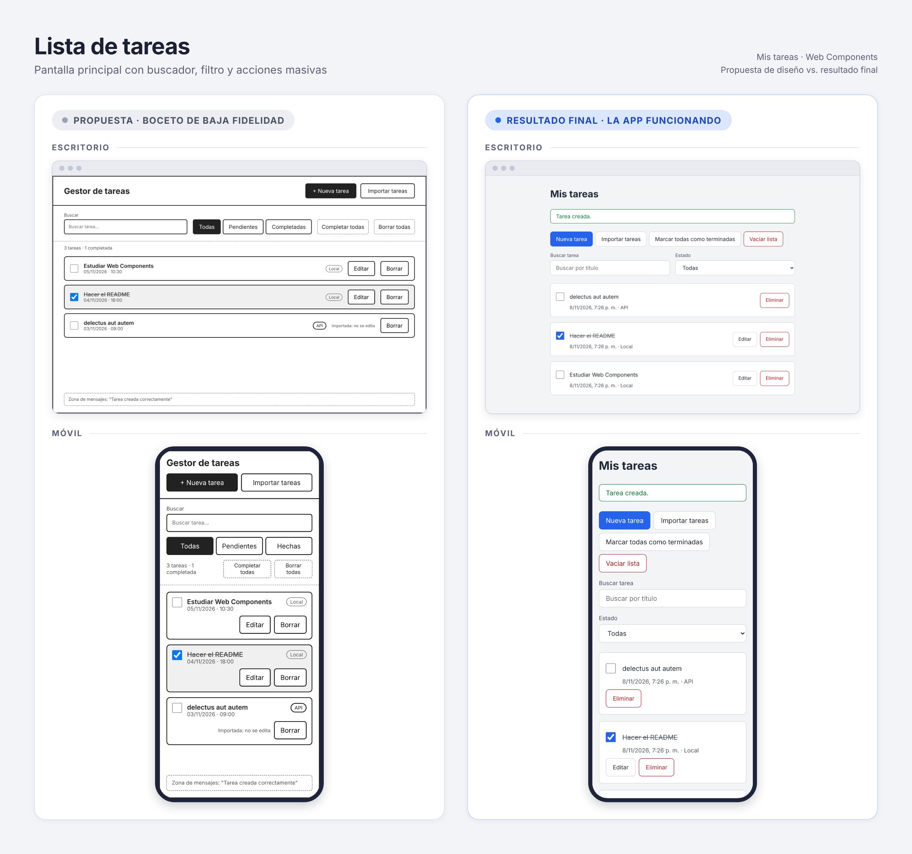
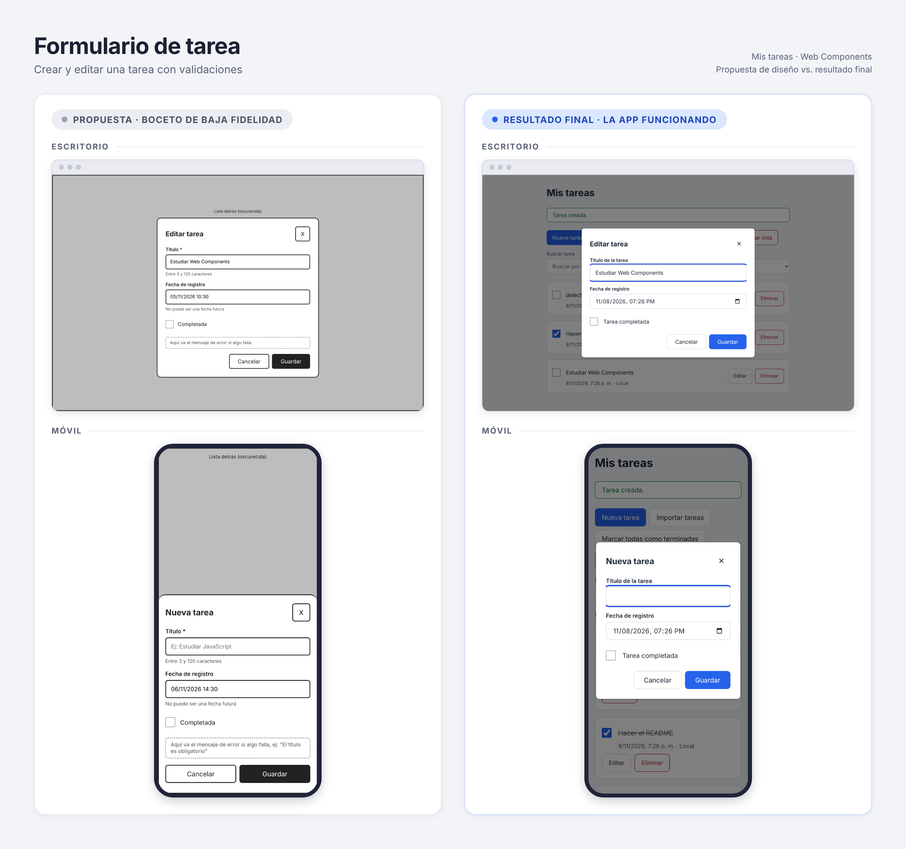
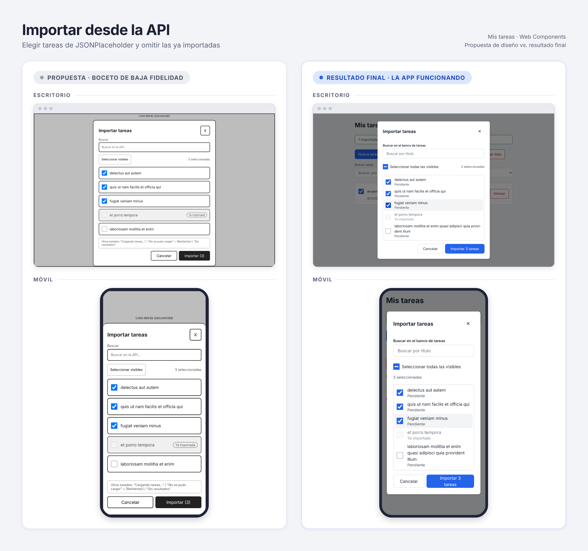
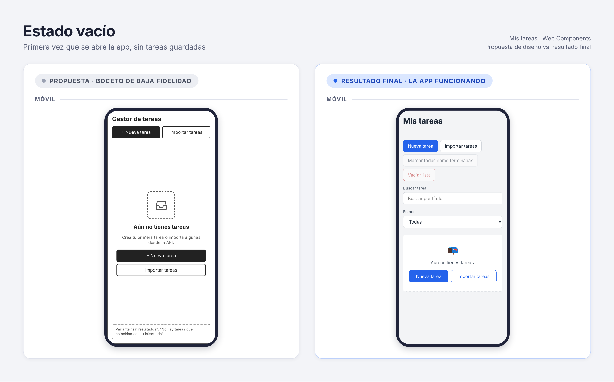

# Diseño y lógica de la aplicación

Este documento explica cómo está organizada la app, cómo se comunican los componentes y qué cambió entre la propuesta de diseño y el resultado final.

## 1. Arquitectura

La app usa solo HTML, CSS y JavaScript nativos. Cada pieza de la interfaz es un **Custom Element** con **Shadow DOM** (`attachShadow({ mode: 'open' })`), y cada componente se registra en su propio archivo con `customElements.define`. `main.js` solo importa los componentes.

```
Gestion_Tareas/
├── index.html
├── css/global.css
└── js/
    ├── main.js
    ├── components/
    │   ├── task-app.js        # componente raíz: dueño del estado
    │   ├── task-toolbar.js    # botones, buscador y filtro
    │   ├── task-list.js       # lista y estados vacíos
    │   ├── task-item.js       # una tarea
    │   ├── task-form-modal.js # formulario crear / editar
    │   ├── import-modal.js    # importar desde la API
    │   ├── confirm-dialog.js  # confirmaciones
    │   └── app-modal.js       # modal base reutilizable (<dialog>)
    ├── services/
    │   ├── storage.js         # localStorage
    │   └── api.js             # JSONPlaceholder
    └── utils/
        ├── utils.js           # filtro, formato de fechas, foco
        └── validators.js      # validaciones del formulario
```

### Una sola fuente de verdad

`task-app` es el **único** componente que guarda el estado y el único que habla con `storage.js`. Los demás componentes no conocen las tareas guardadas: reciben datos por propiedades y avisan lo que el usuario hizo con **eventos**.

Flujo: evento del usuario → `task-app` actúa sobre `storage.js` → `task-app` vuelve a leer y repinta.

### Eventos

Todos los eventos se emiten con `bubbles: true` y `composed: true`, para que atraviesen los Shadow DOM hasta `task-app`.

| Evento | Lo emite | Datos |
|---|---|---|
| `task:toggle` | task-item | `{ id, completado }` |
| `task:edit-request` | task-item | `{ id }` |
| `task:delete-request` | task-item | `{ id }` |
| `task:create-request` | task-toolbar, task-list | — |
| `task:save` | task-form-modal | `{ id?, titulo, fechaRegistro, completado }` |
| `import:open` | task-toolbar, task-list | — |
| `import:confirm` | import-modal | `{ tasks }` |
| `filter:change` | task-toolbar | `{ status }` |
| `search:change` | task-toolbar | `{ query }` |
| `tasks:complete-all` | task-toolbar | — |
| `tasks:clear-all` | task-toolbar | — |
| `confirm:accept` | confirm-dialog | `{ action, payload }` |
| `confirm:cancel` | confirm-dialog | `{ action, payload }` |
| `modal:close` | app-modal | — |

## 2. Modelo de datos y persistencia

Las tareas se guardan en `localStorage` con la clave `tasks:v1`.

```js
{
  id: "LOC-<uuid>" | "API-<id>",
  titulo: "string",
  fechaRegistro: "2026-11-07T17:07:00.000Z",  // ISO 8601
  completado: false,
  origen: "local" | "api",
  apiId: null | number,
  imported: false | true
}
```

- Las tareas locales tienen `id` con prefijo `LOC-` y `apiId: null`.
- Las tareas importadas tienen `id` con prefijo `API-`, `origen: "api"`, `apiId` con el id de JSONPlaceholder e `imported: true`.
- `imported` siempre coincide con `origen === "api"`.
- `id`, `origen`, `apiId` e `imported` no se modifican después de crear la tarea.
- Si `localStorage` falla al guardar, `storage.js` lanza un `Error` y `task-app` muestra el mensaje en vez de romper la app.

### Reglas de las tareas importadas

- Solo se puede cambiar `completado` y eliminarlas. No se edita título ni fecha.
- El botón **Editar** no aparece en `task-item` cuando `imported` es `true`.
- `storage.js` lo refuerza: `updateTask` lanza un error si se intenta cambiar otro campo de una tarea importada.
- Una tarea importada no se puede importar dos veces: `import-modal` deshabilita las que ya existen ("Ya importada") y `addTasks` omite duplicados por `apiId`.
- Todas las tareas de un mismo lote importado comparten la misma `fechaRegistro`: el momento de confirmar la importación.

## 3. Validaciones (`validators.js`)

Son funciones puras que devuelven `{ valid, error }`.

- **Título:** obligatorio, se recorta con `trim()` y debe tener entre 3 y 120 caracteres.
- **Fecha:** debe ser válida y no puede ser futura (con 1 minuto de tolerancia por el desfase del reloj).

Además, el campo de fecha del formulario no deja elegir una fecha futura. Son dos capas: el campo la bloquea al elegir y `validateDate` la rechaza si llega de otra forma.

## 4. Accesibilidad y pantallas pequeñas

- La interfaz se adapta a pantallas de 320 px y 390 px de ancho: no hay desplazamiento horizontal, los botones de la barra pasan a otra línea y cada tarea muestra sus botones debajo del título.
- Los modales usan `<dialog>` con `showModal()`, cierre con `Escape` y trampa de foco con Tab.
- Al cerrar un modal, el foco vuelve al elemento que lo abrió.
- Los avisos y los estados de carga usan regiones `aria-live`; los errores usan `role="alert"`.
- Los botones y campos miden al menos 44 px de alto.
- Los títulos de las tareas se pintan con `textContent`, nunca con `innerHTML`.

## 5. Propuesta de diseño vs. resultado final

En la etapa de diseño se dibujaron bocetos de baja fidelidad de las vistas principales. Cada lámina pone el **boceto a la izquierda** y la **app terminada a la derecha**, en escritorio (1100 × 700 px) y en móvil (390 × 844 px), para comparar lo que se planeó con lo que quedó.

### Lista de tareas



### Formulario de tarea



### Importar desde la API



### Estado vacío



Las capturas sueltas de cada lámina están en la carpeta [`wireframes/`](wireframes/): los bocetos son `01` a `07` y las capturas de la app terminada empiezan con `final-`.

### Qué cambió y por qué

| Elemento | Propuesta | Resultado final | Motivo |
|---|---|---|---|
| Filtro por estado | Tres botones (Todas, Pendientes, Hechas) | Lista desplegable "Estado" | Ocupa menos espacio y se maneja bien con teclado. |
| Acciones masivas | "Completar todas" y "Borrar todas" | "Marcar todas como terminadas" y "Vaciar lista" | Los nombres dicen con más claridad qué hace cada botón. |
| Botón de borrar | "Borrar" | "Eliminar" | Mismo texto que usan los avisos y las confirmaciones. |
| Mensajes | Zona de mensajes al final | Aviso con borde verde bajo el título | Se ve justo después de la acción, sin tener que bajar. |
| Tarea importada | Nota "Importada: no se edita" | Solo el botón Eliminar, con etiqueta "API" | Menos ruido: la ausencia de Editar ya lo comunica. |
| Botón de importar | "Importar (3)" | "Importar 3 tareas" | Texto más claro para quien usa un lector de pantalla. |
| Selector de fecha | Campo de texto | Selector nativo de fecha y hora, limitado a "ahora" | Evita escribir fechas con formato incorrecto. |
| Modales en móvil | Hoja que sube desde abajo | Ventana centrada, con el mismo ancho máximo que en escritorio | `<dialog>` con `showModal()` ya trae foco, Escape y fondo oscuro; una ventana centrada funciona igual en todos los tamaños. |
| Estado en el modal de importar | Etiqueta "Ya importada" a la derecha del título | Texto de estado (Pendiente, Completada, Ya importada) debajo del título | El título ocupa todo el ancho y las palabras largas ya no se cortan en pantallas de 320 px. |
| Confirmaciones | No estaban dibujadas | Cuadro de confirmación para eliminar, marcar todas y vaciar | Son acciones que no se pueden deshacer. |

## 6. Decisiones de diseño

- **Imports en `main.js` y registro en cada archivo:** así un componente se registra una sola vez y nunca hay dos `define` del mismo nombre.
- **`aria-disabled` en lugar de `disabled`** en los botones "Marcar todas" y "Vaciar lista": tras confirmar, el modal devuelve el foco a ese botón y un botón `disabled` no puede recibirlo.
- **Las importadas se pueden marcar como completadas.** El enunciado dice que no se pueden actualizar; esta lectura permite marcarlas como terminadas y solo bloquea título y fecha. *(Decisión del equipo.)*
- **El campo `imported`** se guarda además de `origen` por acuerdo de la pareja. *(Decisión del equipo.)*
